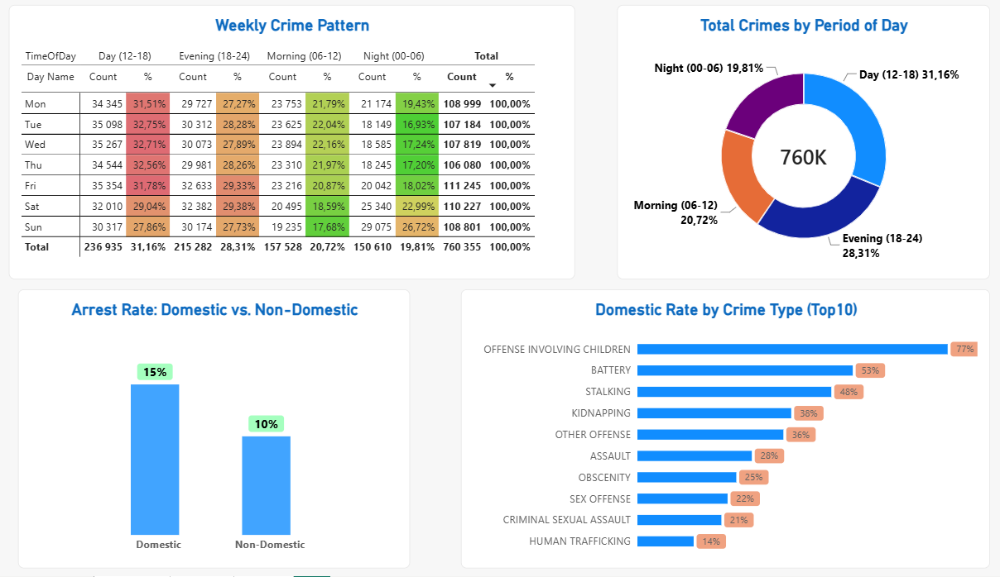
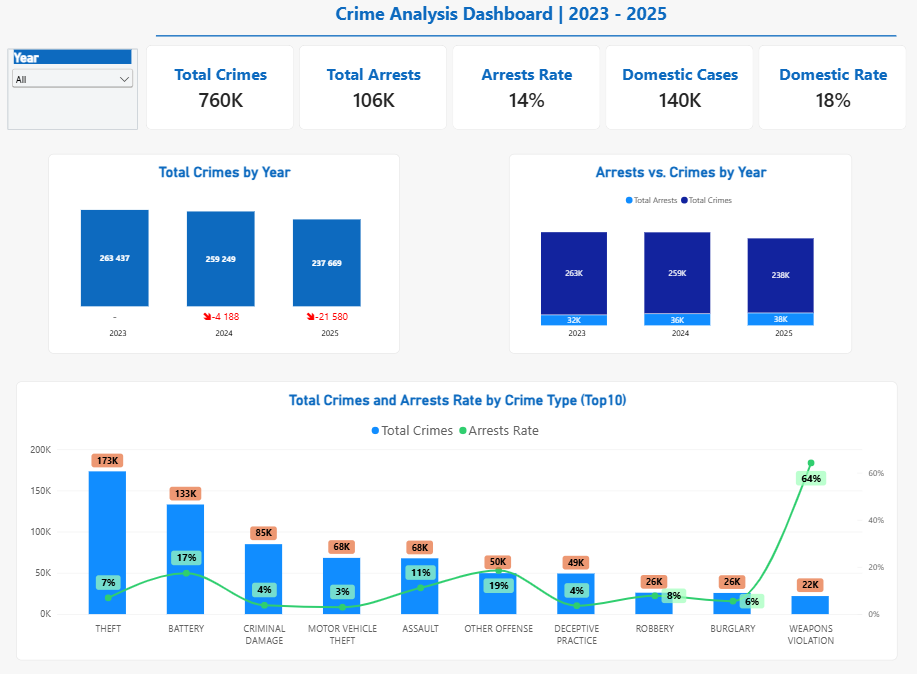
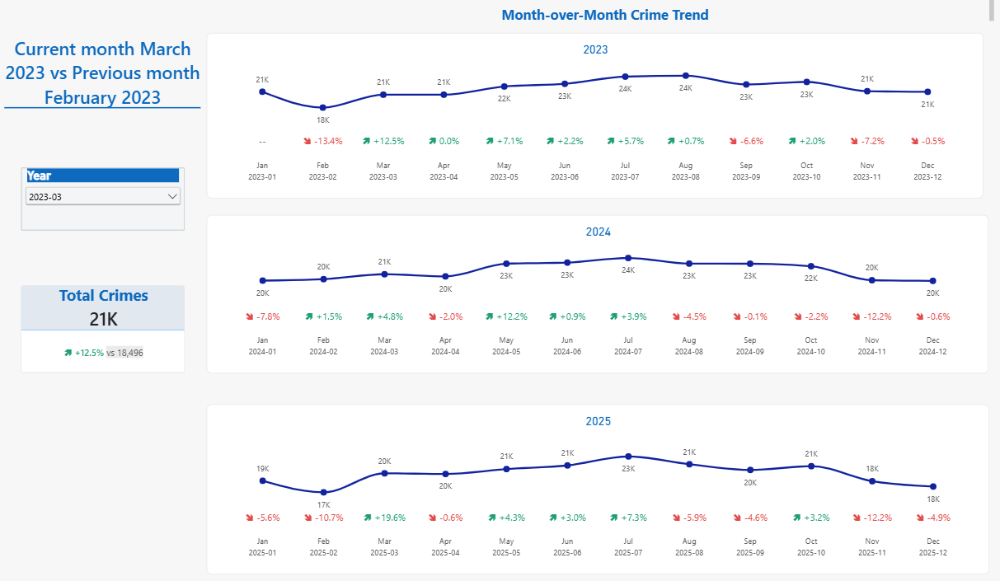
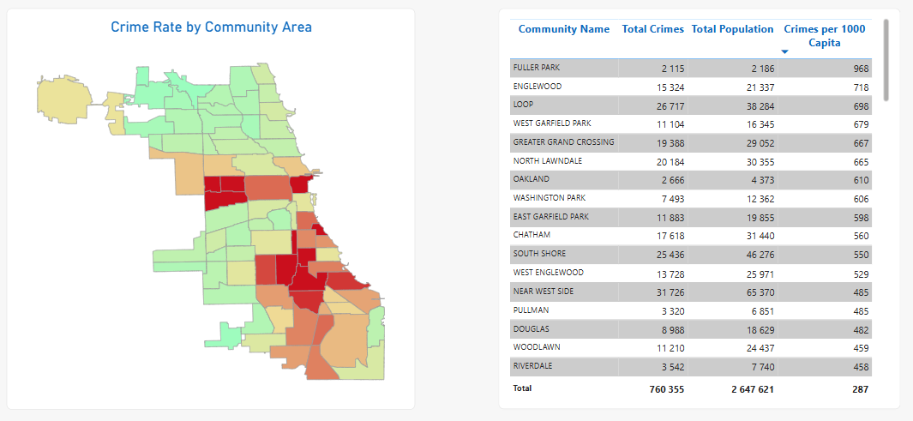

# Chicago Crime Analysis

## Project overview

An interactive Power BI report analyzing reported crime incidents in Chicago.

## Data sources

- Crimes – 2001 to Present: https://data.cityofchicago.org/Public-Safety/Crimes-2001-to-Present/ijzp-q8t2
- Community areas: https://data.cityofchicago.org/
- Population data: https://data.cityofchicago.org/

The report retrieves data from the City of Chicago Data Portal.
The crime query filters records for 2023–2025.

## Tools and methods

- Power BI Desktop
- Power Query for data retrieval and transformation
- DAX measures: [list the measures you created]

## Key findings

Trends (time)

*Total crime has declined for three consecutive years: 263,437 (2023) → 259,249 (2024, -1.6%) → 237,669 (2025, -8.3%). The decline accelerated in the most recent year.
*Friday is the busiest day of the week by total volume (111,245 vs ~106–110K on other days).
\*On weekends, activity shifts toward night hours: the share of nighttime crime rises from 17–19% (weekdays) to 23% (Saturday) and 27% (Sunday), while the morning share drops accordingly — a pattern typical of nightlife (bars/clubs).

Crime types and arrest rate

*THEFT (the category covering minor everyday thefts) and BATTERY (covering both domestic disputes/fights and more serious assaults) dominate by volume across all 31 categories.
*Weapons Violation — low volume, but an arrest rate of ~65% (the highest in the top 10) — because it is a "process crime": the discovery of a weapon is usually accompanied by an arrest on the spot.
\*Motor Vehicle Theft and Criminal Damage — conversely, high volume but an arrest rate of only ~3–5% — typical categories where the suspect is hard to identify after the fact.

Domestic

*18% of all crimes are flagged as domestic.
*Domestic incidents have a higher arrest rate (15%) than non-domestic ones (10%) — which makes sense, as the offender is usually already known to the police and the victim.
\*The highest share of domestic cases is found in Offense Involving Children (~75–80%), Battery (~50%), Stalking (~45%) and Kidnapping (~35%) — categories that are by definition closely tied to family or partner relationships.

Space (community area map)

*The distribution of crimes per 1,000 capita across community areas is uneven but consistent (Shape Map): northern areas consistently show lower rates, while central and southwestern areas show higher ones. This aligns with Chicago's socio-economic geography — a consequence of structural factors from the mid-20th century (redlining, deindustrialization, concentrated poverty) rather than noise in the data.
*Two caveats apply, however: (a) sparsely populated areas produce statistically unstable rates (small-sample effect); (b) commercial and downtown areas (Loop, Near West Side) are overstated, because population counts residents only, while crimes occur among the entire daytime flow of people (workers, tourists).

## Report preview

## Files

- `chicago_crime_analysis.pbix` — Power BI report
- `screenshots/` — report screenshots

## How to view

Download the `.pbix` file and open it with Power BI Desktop.
